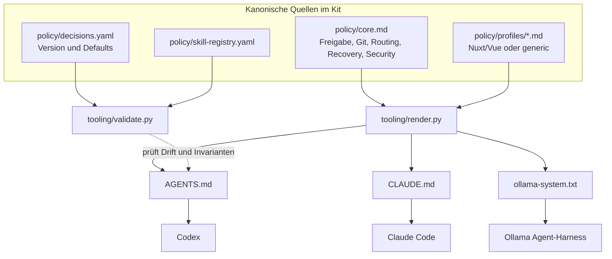
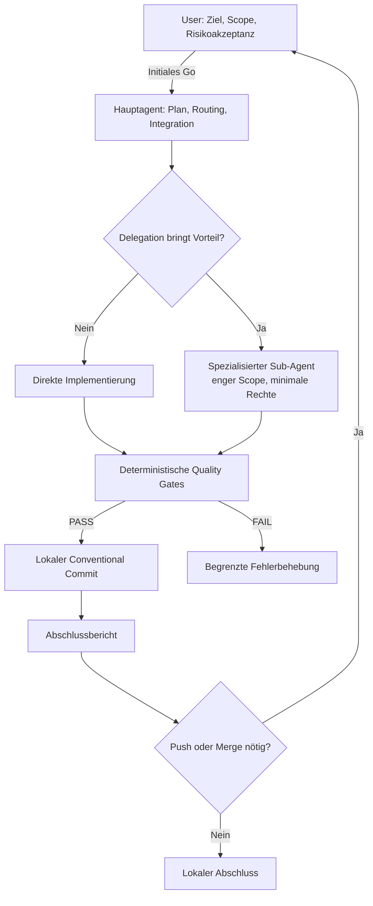

# 01 – Architektur und Verantwortlichkeiten

## Das Problem, das dieses Kit löst

Eine einzige riesige Custom-Instruction-Datei vermischt häufig persönliche Verhaltensregeln, konkrete Framework-Versionen, runtime-spezifische Kommandos und Sicherheitsberechtigungen. Das ist redundant, teuer im Kontextverbrauch und zwischen Claude Code, Codex und lokalen Modellen schwer portierbar.

Die gewählte **Three-Layer Architecture (D-10)** trennt diese Interessen. Der Universal Core ist die maßgebliche Policy-Quelle; Projekt- und Runtime-Regeln ergänzen ihn, ohne ihn heimlich zu lockern.

## Layer 1 – Universal Core

In [`policy/core.md`](../policy/core.md) stehen ausschließlich übertragbare Anweisungen. Beispiele: **zuerst Scope genehmigen**, dann im genehmigten Rahmen arbeiten; Git Push/Merge nur nach Freigabe; keine stillschweigende kostenpflichtige Cloud-Eskalation; Fehlerbehebung mit festem Retry-Budget. Die tatsächlichen Grenzwerte sind in [`policy/decisions.yaml`](../policy/decisions.yaml) festgehalten.

## Layer 2 – Runtime-Adapter

Runtime-Adapter verbinden die Regeltexte mit den Lademöglichkeiten einer konkreten Umgebung. Claude Code kann `CLAUDE.md` nutzen, Codex `AGENTS.md`; ein Ollama-Harness muss den generierten System-Prompt an sein Modell übergeben. **Der Adapter beschreibt nicht dieselbe Policy nochmals von Hand.** Tool-Rechte, Hooks und Isolation sind je Runtime gesondert zu konfigurieren.

## Layer 3 – Projektprofile

Ein Nuxt-Projekt benötigt andere Tech-Stack-Konventionen als ein Python-Projekt. Projektprofile tragen die technischen Vorgaben und lokale Testbefehle. `nuxt-vue` bevorzugt Nuxt UI, Tailwind, Pinia für tatsächlich geteilten Domain-State und Vitest für passende Tests. `generic` enthält keine Nuxt-Pflicht. Ein Projektscope darf die Sicherheitsregeln nicht abschwächen.

## Rollen- und Entscheidungsgrenzen

Die Freigabe für einen Implementierungsauftrag bedeutet **nicht**, dass alle möglichen Subaktionen erlaubt sind. Das Hauptmodell trägt die Integrationsverantwortung. Sub-Agenten bekommen keine zusätzlichen Rechte durch ihren Modelltyp.

## Modell-Routing ist absichtlich abstrakt

- **LIGHT** für Routine und mechanische Aufgaben.
- **BALANCED** für Standard-Coding, gezielte Tests und Debugging.
- **DEEP** für Architekturkonflikte, anspruchsvolle Refactorings, schwierige Fehler.
- **CRITICAL** ist eine Risikokennzeichnung, **kein Modellname oder Performance-Tier**.

Ein lokales Modell kann BALANCED nur dann erhalten, wenn Tool-Aufrufe, Kontextlänge und Ergebnisqualität für den betreffenden Task ausreichen. Kein automatischer Modellwechsel wird behauptet, wenn die Runtime ihn nicht unterstützt.

## Single Source of Truth und Policy-Drift

`render.py` erzeugt die verschiedenen Entry-Points aus denselben Eingaben. `validate.py --generated ...` vergleicht den erzeugten Inhalt mit dem erwarteten Inhalt und meldet Unterschiede. Dadurch werden versehentliche Bearbeitungen der generierten Policy sichtbar. Die Prüfung garantiert **nicht**, dass eine Runtime diese Datei auch wirklich geladen hat; dazu dient ein [Smoke-Test](03-runtime-integration.md#smoke-tests).

## Grenzen des Designs

Das Kit ist **kein Orchestrator**: Es startet keine Agenten, zählt Rechenzeit nicht zuverlässig und kann ohne externen Controller nicht verhindern, dass ein Modell ein Retry-Limit missachtet. Diese Aspekte werden als Requirements für den jeweiligen Harness definiert.
