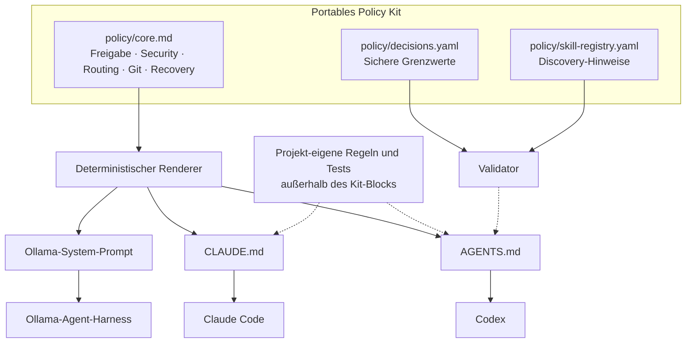
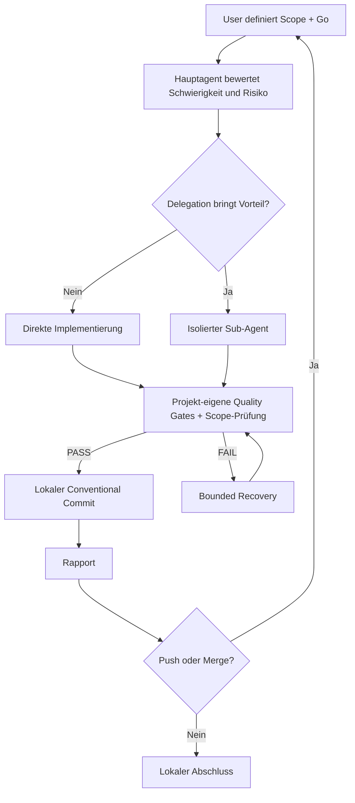

# 01 – Frameworkunabhängige Architektur

Das Kit behandelt **Agentenverhalten** und nicht Projektarchitektur. Es kennt keine bevorzugte Sprache, keine Framework-Pflicht und keine Annahmen über Build-System, UI-Library oder Datenbank. Diese Entscheidungen gehören dem jeweiligen Projekt.

## Drei Ebenen – ohne Technologieprofile

**Layer 1 – Universal Core:** alle D-01–D-11-Entscheidungen. Die Quelltexte enthalten nur provider- und technologieübergreifende Leitplanken.

**Layer 2 – Runtime-Adapter:** Einbindung in die unterstützten Instructions-Formate. Der Adapter selbst kann Sandbox, Permissions oder Tool Calling nicht aktivieren; das geschieht in der jeweiligen Laufzeit.

**Layer 3 – Projekt-eigene Konventionen:** bestehen separat in den bereits vorhandenen Dateien des Projekts. Das Kit installiert kein Projektprofil und erkennt keinen Stack. Diese dritte Ebene liegt **außerhalb des Kits** und darf Security-/Approval-Regeln nicht abschwächen.

## Autonomie und Verantwortung

## Capability-Based Routing

LIGHT bedeutet mechanische Routine, BALANCED Standard-Coding, DEEP schwierige Architektur oder Debugging. Dies sind **Leistungsprofile für Modelle**, nicht Programmiersprachen- oder Projektprofile. CRITICAL ist eine unabhängige Risikoflagge. Ein teures Modell bekommt nicht automatisch weitreichendere Berechtigungen.

## Versionierung und Drift

`render.py` erzeugt alle Runtime-Texte aus `core.md`. `validate.py` erkennt Änderungen gegenüber der kanonischen Vorlage. Der Installer verwaltet nur explizit gekennzeichnete Blöcke in `AGENTS.md` und `CLAUDE.md`; andere Projektregeln bleiben bestehen. Der User muss vor der Ausführung verifizieren, dass die jeweilige Runtime die Policy tatsächlich geladen hat.
