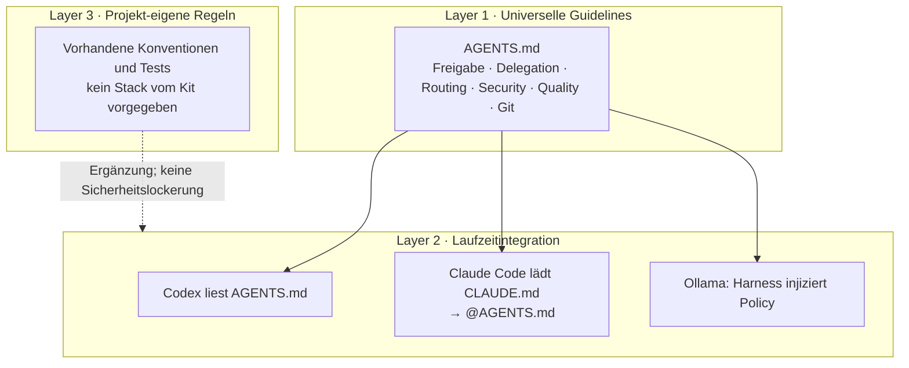
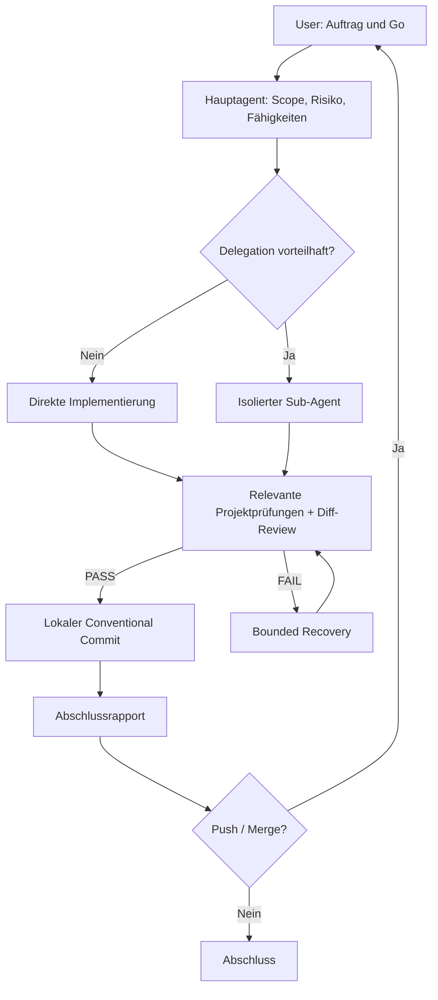

# 01 – Architektur: eine Policy, mehrere Laufzeiten

Das Kit standardisiert **das Verhalten von Coding-Agenten**; es trifft keinerlei Entscheidungen über Programmiersprachen, Frameworks, Architektur, Testwerkzeuge oder Paketmanager.

## Drei logische Ebenen – zwei Dateien zum Kopieren

- **Layer 1:** Alle Entscheidungen D-01 bis D-11 stehen kompakt und normativ in [`AGENTS.md`](../AGENTS.md).
- **Layer 2:** `CLAUDE.md` ist ein Import-Einstieg. Andere Agent-Harnesses müssen die Datei selbst laden. Berechtigungen, Sandbox, Modellwechsel und Tool Calling sind Funktionen der Runtime, nicht der Markdown-Dateien.
- **Layer 3:** Projekt-eigene Konventionen bleiben getrennt und dürfen universelle Sicherheitsgrenzen nicht stillschweigend lockern.

## Autonomie und Verantwortung

LIGHT, BALANCED und DEEP bezeichnen *Modell-Leistungsprofile*. CRITICAL bezeichnet *Aufgabenrisiko* und erfordert zusätzliche Kontrolle. Kein Modell wird durch die Dokumentation technisch gewechselt.

## Keine versteckte Installation oder Synchronisierung

Kopieren ist eine einmalige Dateioperation. Eine spätere Aktualisierung heißt: neue `AGENTS.md` mit dem vorhandenen Projektstand vergleichen und Änderungen gezielt zusammenführen. **Es gibt keinen Generator und keine automatische Verteilung.**

Siehe [Kopieranleitung](09-dateien-kopieren.md) und [Runtime-Integration](03-runtime-integration.md).
