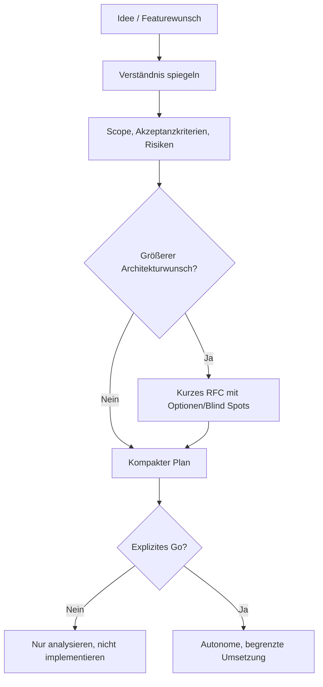
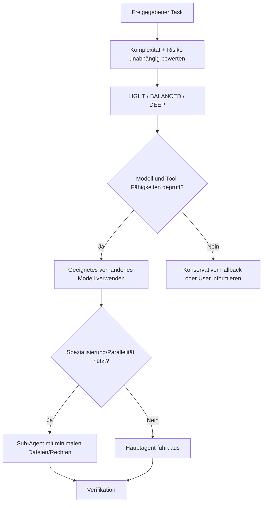
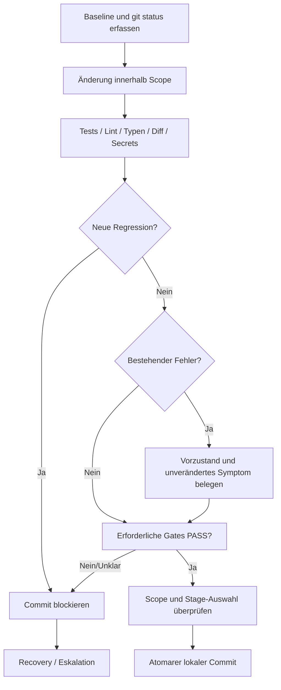
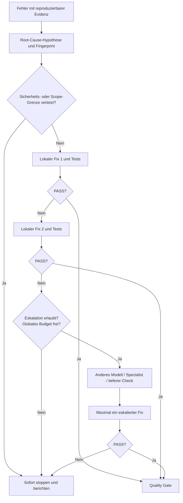
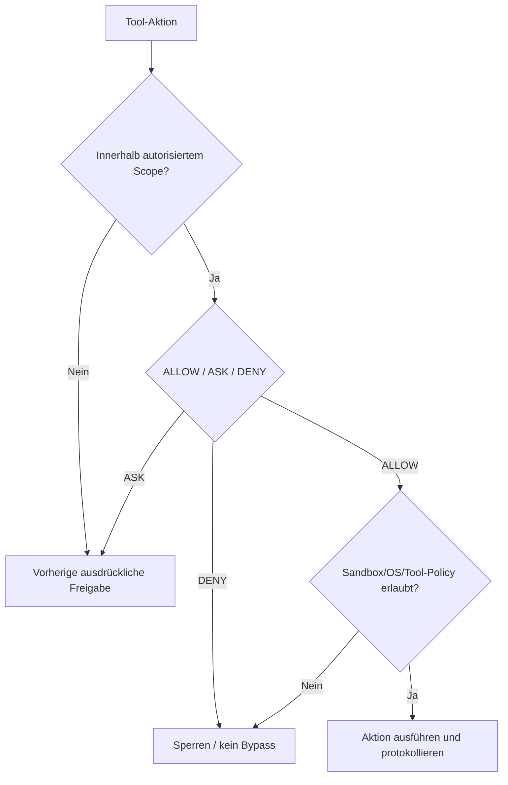
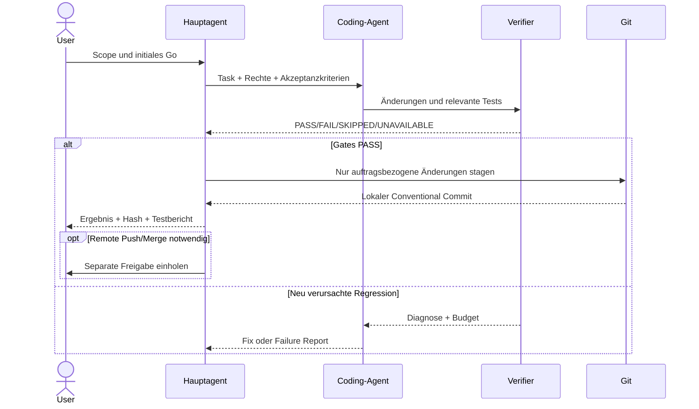

# 02 – End-to-End Workflows und Mermaid-Diagramme

Dieses Kapitel zeigt die tatsächlich vorgesehenen Zustandsübergänge. Ein Flussdiagramm beschreibt die **Soll-Regel**, nicht automatisch eine vorhandene technische Durchsetzung.

## A. Von der Idee zum freigegebenen Auftrag



**Beispiel:** „Ich möchte eine bestehende Session-Erneuerung robuster machen.“ Vor dem Go benennt der Agent bestehende Session-Verantwortlichkeiten, Schnittstellen, Fehlerzustände und mögliche Race Conditions. Nach dem Go darf er nur den vereinbarten Umfang ändern.

## B. Capability-basiertes Modell- und Agentenrouting



Die Empfehlung „nutze DEEP“ ist nicht dasselbe wie ein durchgeführter Modellwechsel. **CRITICAL** führt unabhängig vom Modell zu strengeren Prüfungen/Freigaben.

## C. Quality Gates vor dem lokalen Commit



Bei MEDIUM sind anwendbare Tests und statische Prüfungen erforderlich. Bei HIGH zusätzlich erweiterte Verifikation und separate Freigaben für riskante Operationen. `agent-verify.sh` führt nur ausgewählte Checks aus und kann nicht alle Aufgabenrisiken automatisch bewerten.

## D. Fehlerbehebung mit begrenztem Retry-Budget



Beschlossene Default-Grenzen: **2 lokale + 1 eskalierter Fix pro Ursache**, **6 Korrekturen insgesamt pro Task**, **maximal 2 parallele Schreibagenten**. Diagnoseaufrufe zählen nicht als Fix. Das bloße Umbenennen einer Ursache setzt den Zähler nicht zurück. Für zuverlässige Einhaltung über Sessions hinweg braucht es externe Zustandsverwaltung.

## E. Berechtigungs- und Sicherheitsablauf



Ein bestehender Projekt-Testbefehl ist nicht automatisch ungefährlich: Ein Projekt kann beliebige Lifecycle-Skripte definiert haben. Neues oder unerwartetes Skriptverhalten muss vor der Ausführung geprüft werden.

## F. Git-Ablauf vom Arbeitsauftrag bis zur Versionierung



## Beispiel für einen kurzen Abschlussrapport

```yaml
task: TASK-42
scope: "Session-Renewal Bugfix"
result: completed
checks:
  targeted_tests: PASS
  typecheck: PASS
  lint: SKIPPED # mit dokumentierter Begründung
  build: UNAVAILABLE # nicht als PASS melden
commit: "fix(auth): serialize token refresh"
remote_push: NOT_PERFORMED
outstanding_risks: ["Produktionssession nicht live verifiziert"]
```
