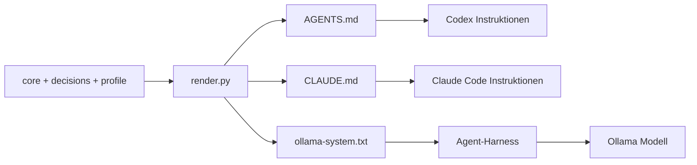
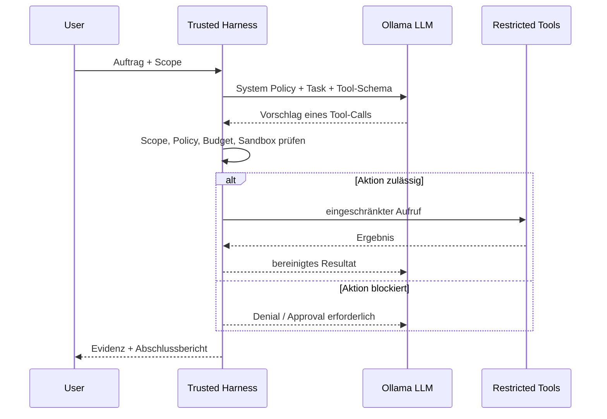

# 03 – Runtime-Integration: Claude Code, Codex und Ollama

## Erstinstallation und Workflow

```bash
python3 --version                    # Python >= 3.10
python3 tooling/validate.py
python3 -m unittest discover -s tests -v
python3 tooling/render.py --config templates/project.yaml --out ./dist/example
python3 tooling/validate.py --config templates/project.yaml --generated ./dist/example
```

**Wichtig:** `render.py` installiert nichts im Home-Verzeichnis und überschreibt ohne explizites `--force` keine Dateien. Selbst mit `--force` dürfen nur zuvor generierte Dateien ersetzt werden; Symlink-Ziele werden abgelehnt.

## Einbindungsvarianten



## Claude Code / Claude Desktop Code-Tab

1. Generierte `AGENTS.md` und `CLAUDE.md` nach Sichtprüfung in die Projektwurzel übernehmen.
2. Die generierte `CLAUDE.md` bindet `@AGENTS.md` ein. Das Verhalten hängt von Version und Workspace-Konfiguration ab; mit einem einfachen Smoke-Test überprüfen, ob die Policy geladen wird.
3. Native Permissions, Hook-Skripte, Sandbox und optionale Sub-Agent-Definitionen gesondert konfigurieren. Die Markdown-Datei ist **keine Tool-Allowlist**.
4. Lokale Commits nur nach relevanten Quality Gates. Für Push und Merge separate Freigabe.

Für macOS und Linux dieselben Policy-Dateien verwenden; lokale Tool-Pfade und Package-Manager bleiben projektspezifisch.

## Codex

1. Generierte `AGENTS.md` in das Repository übernehmen.
2. Eine restriktive Sandbox und Genehmigungslogik nutzen, zum Beispiel:

```toml
sandbox_mode = "workspace-write"
approval_policy = "on-request"
```

3. Je nach Sandbox sind `.git`-Schreiboperationen geschützt. Lokale Commits nur über einen zulässigen, separat autorisierten Mechanismus ausführen; **nicht** pauschal die Sandbox deaktivieren.
4. Bei Überschreibungen oder abweichenden `AGENTS.md`-Regeln die effektiven Instruktionen prüfen, statt ihre erfolgreiche Ladung anzunehmen.

## Ollama + Agent-Harness

Ollama betreibt das Modell, nicht automatisch den Coding-Agenten. Das Kit enthält `ollama-system.txt` als Instruktionsartefakt; die tatsächliche Ausführung verantwortet ein separater Harness.



Der Harness muss die Anforderungen aus [`adapters/ollama/harness-contract.md`](../adapters/ollama/harness-contract.md) erfüllen: Aufruf-Admission **außerhalb** des Modells, Tool-Isolation, Approval, geteiltes Retry-Budget und Audit. Wenn das nicht möglich ist, nur read-only evaluieren und Schreibzugriffe deaktivieren.

### Beispiel für einen Modelltest (nur lokal, ohne echte Secrets)

- **Tool Calling:** Kann das Modell ein Schema korrekt befüllen und Tool-Antworten verwenden?
- **Context:** Kann es eine begrenzte Projektdatei zusammen mit Scope und Akzeptanzkriterien verarbeiten?
- **Security:** Verweigert der Harness unauthorisierte Pfade tatsächlich, auch wenn das Modell einen Aufruf versucht?
- **Quality:** Erkennt der Agent fehlgeschlagene Tests, statt den Commit freizugeben?

## Skill-Discovery

`python3 tooling/validate.py --check-skills --project /pfad/zum/repo` prüft bekannte Skill-Verzeichnisse und meldet `FOUND` oder `NOT DETECTED`. Es prüft **nicht** Herkunft, Version oder Sicherheit des Skills. Nur aufgabenrelevante Skills laden und niemals ohne Freigabe installieren.

## Smoke-Tests

- Policy-Version und D-01/D-09-Regel aus tatsächlich geladenem Kontext abfragen; Antwort mit `policy/core.md` vergleichen.
- In einer Wegwerf-Arbeitskopie einen harmlosen Schreibversuch außerhalb des Scopes auslösen; erwartet wird eine blockierte Aktion oder Freigabeaufforderung.
- Ein falsches `.env`-Beispiel (kein echtes Secret) vor unerlaubtem Lesen schützen.
- Push und Dependency-Installation in einem Testprojekt auf notwendige Freigaben prüfen.
- Tests absichtlich fehlschlagen lassen und nachweisen, dass kein ungeprüfter lokaler Commit erfolgt.

Weitere Grenzen in [`SECURITY.md`](../SECURITY.md).
