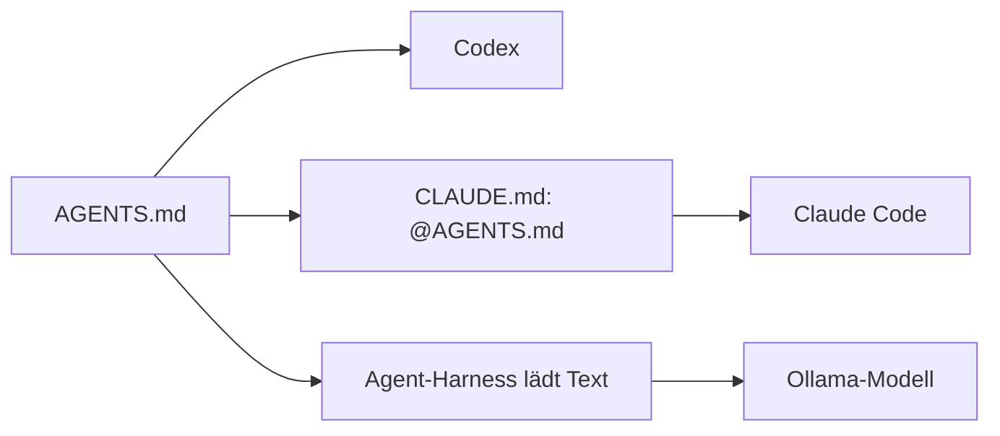
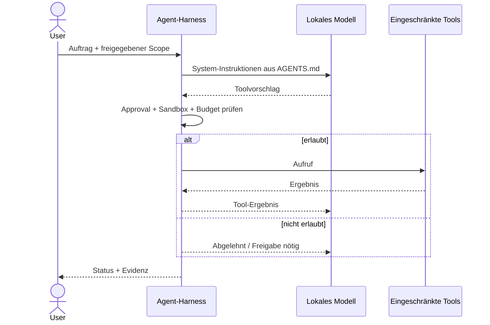

# 03 – Runtime-Integration: Claude Code, Codex, Ollama

**Keine Installation notwendig.** Kopiere `AGENTS.md` und bei Claude Code zusätzlich `CLAUDE.md` in ein beliebiges Projekt. Bei gleichnamigen Dateien vorher Inhalte vergleichen und manuell zusammenführen.

## Codex

- Die Datei `AGENTS.md` in der Projektwurzel ablegen oder in bestehende Projektinstruktionen integrieren.
- Die effektive Instruktionshierarchie und allfällige überschreibende Dateien prüfen.
- Toolrechte, Sandbox und Approval-Policy werden **nicht** durch `AGENTS.md` konfiguriert. Verwende die jeweils verfügbaren Runtime-Einstellungen.
- Verifizieren: Agenten nach der geltenden D-01-Freigaberegel und D-09-Sicherheitsregel fragen, ohne sie im Auftrag erneut zu zitieren.

## Claude Code / Claude Desktop Code-Tab

- `AGENTS.md` und `CLAUDE.md` in die Projektwurzel kopieren.
- Die mitgelieferte `CLAUDE.md` enthält lediglich `@AGENTS.md` als Claude-Code-Import. Prüfe, ob deine Runtime den Import tatsächlich unterstützt und ausführt.
- Gibt es bereits eine `CLAUDE.md`, **nicht überschreiben**: nach Sichtprüfung `@AGENTS.md` dort ergänzen oder die gemeinsamen Regeln manuell integrieren.
- Permissions, Hooks und Sandbox verbleiben in den Runtime-Einstellungen. Ein Import erteilt keine Git- oder Shell-Rechte.

## Ollama und andere lokale Modelle

Ollama selbst führt keine Projekt-Tools aus und liest `AGENTS.md` nicht automatisch. Nur ein **Agent-Harness**, der den Text lädt und Toolzugriffe kontrolliert, kann die Policy auf Coding-Aufgaben anwenden.

## Was immer separat erforderlich bleibt

1. Projekt-eigene Test-/Build-Kommandos, soweit vorhanden.
2. Tatsächlich konfigurierte Datei-, Netzwerk- und Git-Rechte.
3. Bereitgestellte Sub-Agenten-/Modellwahlfunktion, falls gewünscht.
4. Sichere Freigaben bei Hochrisiko-Aktionen.

**Smoke-Test:** Die Laufzeit soll den Inhalt der tatsächlich geladenen Policy korrekt wiedergeben. Zusätzlich in einem ungefährlichen Testprojekt prüfen, dass externe Schreib-/Push-Aktionen nicht ohne Freigabe ausgeführt werden. Kein Smoke-Test mit realen Zugangsdaten.

Weitere Anweisungen: [Dateien kopieren](09-dateien-kopieren.md) und [SECURITY.md](../SECURITY.md).
