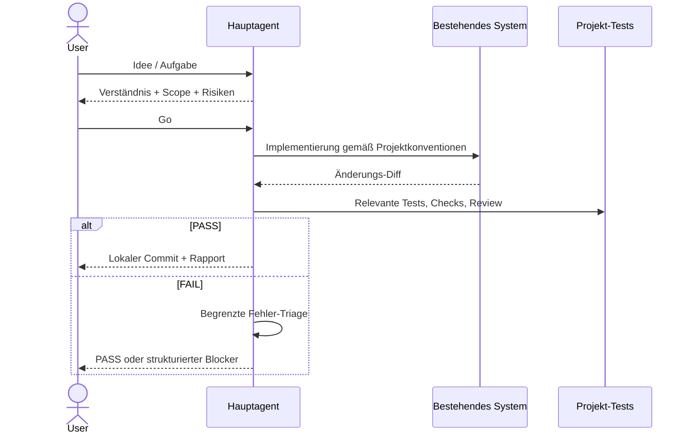
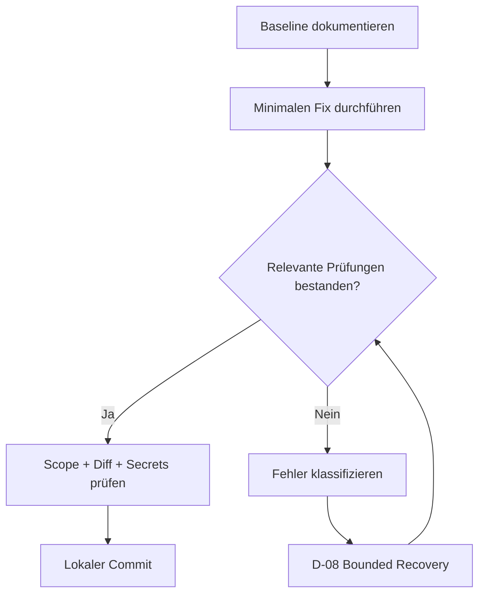
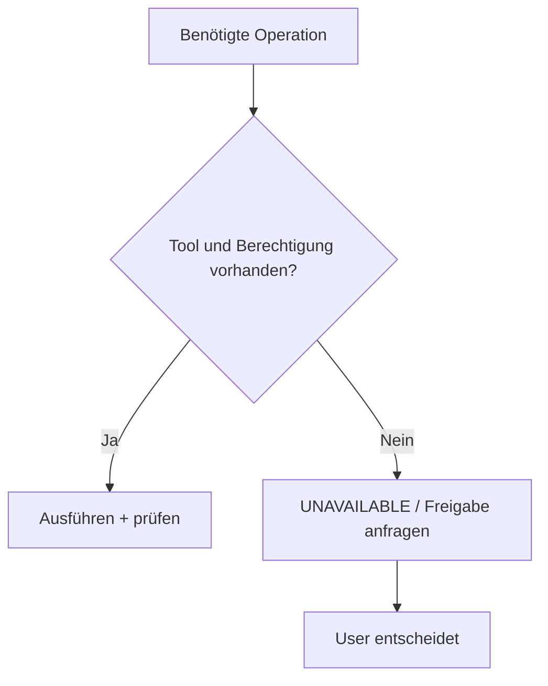

# 04 – Universelle Praxisbeispiele für Agentic Coding

Die folgenden Beispiele funktionieren gedanklich mit jeder Programmiersprache und jedem Framework. Konkrete Tools, Bibliotheken, Testkommandos und Ordnerstrukturen stammen **ausschließlich aus dem jeweiligen Repository** und werden vom Kit weder ausgewählt noch vorgeschrieben.

## Beispiel A – Feature mit End-to-End-Datenfluss

**Auftrag:** „Eine Aktion soll einen neuen Eintrag speichern und dem Benutzer nachvollziehbares Feedback geben.“

Der Agent fragt bei Unklarheit nach Dateneingabe, Validierung, Fehlern und Ergebnisanzeige. Vor einer größeren Implementierung stellt er ein kompaktes RFC mit Scope und Akzeptanzkriterien bereit. Nach dem initialen Go darf er die Änderung innerhalb des Scopes umsetzen.



**Akzeptanzkriterien:** valide Eingaben, verständlicher Fehlerzustand, eindeutig sichtbares Ergebnis, keine stillschweigende API-Änderung, nachweisbare Tests.

## Beispiel B – Bugfix mit vorhandenen Fehlern

**Auftrag:** „Eine validierte Eingabe wird unter einer Randbedingung falsch verarbeitet.“

- Der Agent ermittelt vorhandene Tests und die reproduzierbare Baseline, bevor er die Änderung vornimmt.
- Er erstellt einen möglichst kleinen Fix und prüft relevante Seiteneffekte.
- Bereits vorhandene Fehler dürfen nur mit Evidenz ausgenommen werden; neue Regressionen blockieren den autonomen Commit.
- Ein fehlender Testbefehl bleibt UNAVAILABLE, nicht PASS.



## Beispiel C – Modell oder Runtime verfügt nicht über die benötigten Tools

Ein Agent fordert eine Dateiänderung, die die Laufzeit nicht zulässt. Die Policy verlangt, **nicht** so zu tun, als wäre die Änderung erledigt, und keine Sandbox zu umgehen. Stattdessen muss die fehlende Fähigkeit gemeldet und gegebenenfalls eine autorisierte Alternative vorgeschlagen werden.



Das gilt insbesondere bei Ollama-basierten Modellen, deren Harness die tatsächlichen Tool-Aktionen kontrollieren muss.

## Beispiel D – Fehlerkette mit begrenzten Versuchen

Bei einem fehlgeschlagenen Test hat ein Agent maximal **zwei lokale Fix-Versuche** für dieselbe Root Cause. Anschließend ist **ein eskalierter Fix** zulässig, sofern Fähigkeit und Budget vorhanden sind. Insgesamt bleiben maximal **sechs Korrekturen pro Auftrag** erlaubt. Ein neuer Sub-Agent setzt keine Zähler zurück.

```yaml
failure_report:
  task: "example-42"
  source: "module: relevant function"
  symptom: "targeted test fails"
  baseline: "PASS before change"
  hypothesis: "state transition is not handled"
  local_attempts: 2
  escalated_attempts: 1
  status: "STOP_AND_REPORT"
```

*Das Beispiel zeigt ein Datenformat, keinen realen Testlauf.*

## Beispiel E – Projektspezifische Tests ohne Tool-Zwang

In einem Zielprojekt kann optional eine `.agentic/checks.json` erstellt werden. Das Kit erkennt den Stack **nicht** und führt keine Befehle ungefragt aus.

```json
{"schema": 1, "checks": {"test": ["project-owned-test-command", "--flag"]}}
```

Nach expliziter Prüfung kann der Benutzer `bash .agentic/agent-verify.sh --risk medium --allow-checks` ausführen. Wird der Test nicht konfiguriert oder nicht genehmigt, wird der Check als nicht erfolgreich gemeldet.

## Beispiel F – Fehlender Skill

Ist ein Skill für die konkrete Aufgabe REQUIRED, blockiert nur die abhängige Operation. Ein PREFERRED-Skill darf durch eine vorhandene, geeignete Alternative ersetzt werden; OPTIONAL wird bei geringem Nutzen übersprungen. Ungeprüfte Skill-Skripte dürfen keine Sicherheitsfreigaben erweitern.
