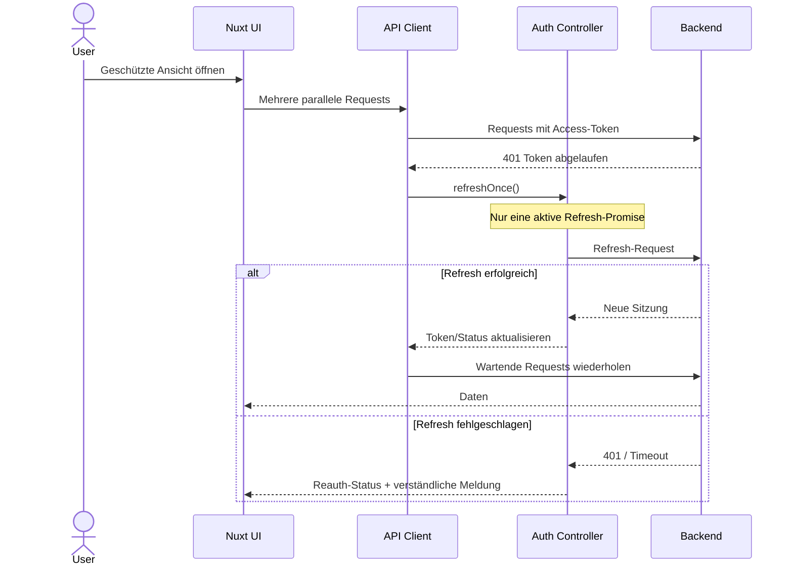
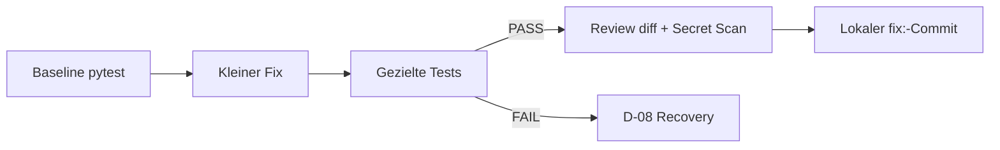

# 04 – Praxisbeispiele von der Idee bis zum Commit

Die folgenden Beispiele illustrieren das beabsichtigte Verhalten. Modellwechsel, Tool-Genehmigungen und Git-Commits laufen nur dann automatisch, wenn sie in der tatsächlichen Runtime erlaubt und technisch implementiert sind.

## Beispiel A – Nuxt: Token-Refresh ohne Race Condition

**Auftrag:** „Beim gleichzeitigen Aufruf mehrerer API-Endpunkte darf der Refresh-Token nur einmal erneuert werden. Fehler sollen im UI verständlich erscheinen.“

### 1. Ideation und Abgleich

Der Hauptagent fasst das Ziel zusammen: Bei abgelaufenem Access-Token werden parallele Requests über einen gemeinsamen Refresh-Vorgang koordiniert. Fehler führen zu einem definierten Logout- oder Reauth-Status, nicht zu unendlichen Retries. Er benennt die betroffenen Zustände: API-Client, Auth-Domain-State, SSR/Hydration und UI-Fehlermeldung.

### 2. Kompakter RFC

| Aspekt | Vorschlag |
|---|---|
| Ziel | Kein doppelter Refresh bei parallelen Requests |
| Option A | Single-flight-Promise im API-Client |
| Option B | Zentraler Refresh-Controller im Auth-Modul |
| Risiko | Race Conditions, SSR-State-Sharing, Token-Leak |
| Akzeptanz | Parallel-Request-Test, Timeout-Test, 401-Fehlerpfad |

Der Agent holt eine **einmalige Freigabe des Implementierungsscopes** ein. Danach sind kleine, reversible Änderungen ohne neues Go erlaubt.

### 3. Technische Ablaufskizze



### 4. Prüfungen und Commit

- Vorher: `git status`, betroffene Tests und bestehende Fehler dokumentieren.
- Tests: parallele API-Aufrufe, timeout, fehlgeschlagener Refresh, unvollständige Session.
- Typecheck/Lint der betroffenen Bereiche, erforderliche weitere Projektprüfungen.
- Nur taskbezogene Dateien stagen, danach lokaler Commit `fix(auth): serialize token refresh`.
- **Kein automatischer Push.** Ein Push ist eine gesondert freizugebende Aktion.

**Achtung:** Das Projektprofil verlangt Pinia für gemeinsam genutzten Domain-State; nicht jeder lokale Loading-Indikator gehört in einen Store. SSR-Zustände nicht versehentlich global zwischen Nutzern teilen.

## Beispiel B – Python-Service: Regression in einer Datenvalidierung

**Auftrag:** „Ein bestehender Validator akzeptiert unzulässige negative Mengen. Korrigiere den Fehler.“

Der Auftrag ist üblicherweise BALANCED und LOW/MEDIUM je nach Bedeutung der Daten. Mit `generic` werden **keine Nuxt- oder npm-Befehle erzwungen**. Die lokale `pytest`-Konfiguration muss als projektspezifische Quality-Gate-Implementation hinterlegt werden; `agent-verify.sh` ist in V1 auf npm-Skripte spezialisiert.



Falls ein Test schon vorher fehlschlug, muss die Ursache am Vorzustand nachweisbar sein. Ein „war vorher schon rot“ ohne Reproduktion ist kein Freibrief.

## Beispiel C – Lokales Ollama-Modell: Repository-Refactoring

**Ausgangslage:** Ein Ollama-Modell soll eine kleine Utility-Funktion umbenennen, ohne Netzwerk oder Dateizugriff außerhalb eines gekapselten Workspace.

Voraussetzungen:

- Agent-Harness lädt den generierten System-Prompt und begrenzt Workspace-Tools technisch.
- Für den Task sind Name, Akzeptanzkriterien und erlaubte Dateien definiert.
- Der Harness kann den Git-Diff lesen und Prüfkommandos ausführen.
- Testläufe und Tool-Calls werden **vor** der Ausführung vom Harness autorisiert.

Geeignetes Profil: LIGHT oder BALANCED **nur nach Capability-Test**. Das lokale Modell muss bei falscher Tool-Ausgabe oder fehlender Fähigkeit auf **UNAVAILABLE/ESCALATE** gehen, statt erfolgreiche Ausführung zu behaupten. Ein Wechsel auf einen kostenpflichtigen Provider ist ohne Freigabe untersagt.

## Beispiel D – Fehlerkette und Retry-Budget

Ein Agent führt Vitest aus: `auth.spec.ts` schlägt fehl. Er schlägt einen Fix vor und testet ihn; das Ergebnis ist weiterhin rot. Er darf einen zweiten begründeten lokalen Fix ausführen. Wenn dieser ebenfalls scheitert, kann der Hauptagent im Rahmen des Budgets einen geeigneten Spezialagenten oder ein DEEP-Profil verwenden. **Danach höchstens ein eskalierter Fix**. Bei weiterem Fehler wird die betroffene Aufgabe kontrolliert gestoppt.

```yaml
task_id: AUTH-REFRESH-01
source: stores/auth.ts:42
test: tests/auth.spec.ts
classification:
  type: introduced_regression
  severity: medium
evidence:
  command: "npm run test -- --run"
  result: FAIL
  baseline: PASS
recovery:
  local_attempts: 2
  escalated_attempts: 1
  task_corrections_total: 3
  result: unresolved
next_action: STOP_AND_REPORT
```

Im echten Projekt ist der Testbefehl aus dem vorhandenen `package.json` zu ermitteln. Die Felder oben sind ein Demonstrationsreport, **kein tatsächlich ausgeführtes Testergebnis**.

## Beispiel E – Skill fehlt

Ein UI-Task sollte `frontend-design` verwenden, der Skill ist aber nicht installiert.

- Wenn er **PREFERRED** ist: vorhandene Nuxt-UI-Konventionen nutzen, Qualität prüfen, im Abschlussbericht „Skill nicht verfügbar / nativer Fallback“ nennen.
- Wenn du ihn für genau diesen Task zu **REQUIRED** erklärst: nur den betroffenen UI-Teil stoppen und einen geprüften Installationsweg vorschlagen.
- Wenn er **OPTIONAL** ist: weiterarbeiten, sofern kein anderes Hindernis besteht.

## Beispiel F – Verbotene Seiteneffekte

Der Agent soll einen Bugfix committen; das `package.json` enthält jedoch einen neuen `posttest`-Script, der einen externen Server kontaktiert. **Nicht automatisch ausführen.** Vorher das Skript und die Abhängigkeiten prüfen, gegebenenfalls Zustimmung einholen oder einen isolierten, sicheren Testpfad wählen. Eine Freigabe für „Bugfix“ beinhaltet keinen pauschalen Netzwerkzugriff.
