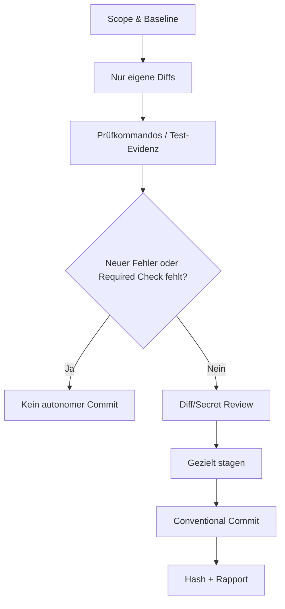

# 05 – Sicherheitsmodell, Quality Gates und Grenzen

## Das Grundprinzip: Layered Security (D-09)

LLM-Anweisungen sind keine vertrauenswürdige OS-Sicherheitsgrenze. Das Kit trennt **Norm** (Policy), **Entscheidung** (Approval) und **Durchsetzung** (Sandbox, Dateirechte, Tool-Wrapper). Der restriktivste anwendbare Schutz gewinnt.

| Operation | Standard | Begründung |
|---|---|---|
| Nicht-sensitive Projektdateien lesen | ALLOW | Erforderlich für Codeverständnis |
| Code innerhalb freigegebenem Scope ändern | ALLOW | Autonome Umsetzung nach Go |
| Überprüfte lokale Tests ausführen | ALLOW | Quality Gate; Skriptwirkung beachten |
| Lokale Conventional Commits | ALLOW nach Gates | Reversibel, lokal, D-02 |
| Paketinstallation, neuer Netzwerkzugriff | ASK | Supply-Chain- und Seiteneffekt-Risiko |
| Push, Merge, Rebase, History-Rewrite | ASK | Externe oder weitreichende Git-Wirkung |
| Produktive Migration oder Deployment | ASK | Mögliche irreversiblen Folgen |
| Secret-Dateien direkt lesen, Zugangsdaten exportieren | DENY by default | Sensible Daten |
| Sandbox/Approval heimlich deaktivieren | DENY | Schutzgrenze muss erhalten bleiben |

Eine `ASK`-Operation bleibt blockiert, bis der konkrete Pfad, das Ziel und die geplanten Folgen autorisiert wurden. Ein Nutzer-„Go“ für Implementierung umfasst nicht automatisch jede `ASK`-Operation.

## Risikoadaptive Qualität (D-07)

| Gate | LOW | MEDIUM | HIGH |
|---|---|---|---|
| Scope/Diff/Secrets/Whitespace | Pflicht | Pflicht | Pflicht |
| Gezielte Tests | Wenn relevant | Pflicht | Pflicht |
| Typen und Lint | Wenn relevant | Für betroffene Bereiche | Für betroffene Bereiche |
| Build / Integration | Bei Bedarf | Bei Bedarf | Pflicht, soweit anwendbar |
| Threat-/Side-Effect-Review | Anlassbezogen | Risikobasiert | Vertieft |
| Separates High-Risk-Approval | Bei Risikowechsel | Bei Risikowechsel | Ja, für Hochrisiko-Operationen |

**Nicht ausgeführt = nicht bestanden.** Statuswerte: `PASS`, `FAIL`, `SKIPPED` (begründet), `UNAVAILABLE` (nicht ausführbar). Ein Baseline-Fehler darf nur mit reproduzierbarer Evidenz ausgenommen werden.

## Vor einem Commit

Welche Prüfbefehle und Secret-Scanner verwendet werden, bestimmt das Zielprojekt. Die Markdown-Policy enthält selbst keinen Scanner und führt keinen Test aus.

## Angehaltene Aufgaben sind nicht automatisch Rückbauten

Im Fehlerfall dürfen Agenten **nicht** automatisch User-Änderungen löschen oder ein `git reset --hard` ausführen. Der Rapport muss enthalten: betroffene Dateien, derzeitige Zustände, Fehlersignatur, Versuche, offene Prüfungen und einen sicheren Wiederaufnahmepunkt.

## Threat-Modell und typische Angriffe

| Risiko | Gegenmaßnahme |
|---|---|
| Prompt Injection in README oder Quellcode-Kommentaren | Externe Inhalte als Daten behandeln, nie als Permission-Upgrade |
| Unkontrollierter Tool Call über lokales LLM | Tool-Aufrufe im Harness vor Ausführung überprüfen |
| Secret-Leak aus `.env` | Dateizugriff technisch verhindern, Ausgabe redigieren |
| Dependency-Lifecycle-Skript mit Netzwerkaktion | Skript vor neuer Ausführung prüfen; ASK-Netzwerkpolitik |
| Sub-Agent arbeitet außerhalb Scope | Eigene enge Datei- und Permission-Grenzen |
| Endloses Debugging | 2+1 Fix-Limit, global 6, externer persistenter Counter empfohlen |
| Widersprüchliche Policy-Dateien | Manuelle Diff-/Link-Prüfung und gezieltes Review |

## Grenzen der Markdown Edition

- Keine automatische OS-/Container-Sandbox, Authentifizierung, Testausführung oder Secret-Prüfung.
- Keine automatische Synchronisierung über Projekte hinweg: Updates durch manuelle Diff-Prüfung.
- Runtime-Rechte, persistente Retry-Zähler und Sub-Agent-Limits müssen gegebenenfalls extern erzwungen werden.
- Nicht jede Runtime lädt `AGENTS.md` oder `CLAUDE.md` automatisch; das tatsächliche Laden ist gesondert zu prüfen.

Siehe auch [`SECURITY.md`](../SECURITY.md).
