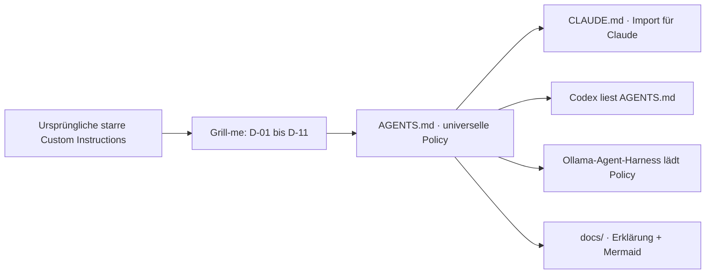

# 06 – Entscheidungen aus der Grill-me-Session (D-01 bis D-11)

Dieses Kapitel dokumentiert die Ergebnisse des gemeinsamen Interviews als **nachvollziehbare Entscheidungsakte**, nicht als vollständiges Gesprächsprotokoll. Es beschreibt die Motivation, verworfene Alternativen und technische Folgen. Normativ bleibt [`AGENTS.md`](../AGENTS.md). Die Entscheidungsakte ist bewusst reine Markdown-Dokumentation.

## Entscheidungsübersicht

| ID | Beschluss | Warum diese Variante? | Konsequenz |
|---|---|---|---|
| D-01 | **B – Risk-Based Autonomy** | Autonomie und strategische Kontrolle verbinden | Ein initiales Go; neu genehmigen bei Risiko-/Scope-Wechsel |
| D-02 | **B – Autonomous Local Commits** | Lokal atomar versionieren ohne ungefragten Remote-Effekt | Conventional Commits nach Gates; Push/Merge nur mit Approval |
| D-03 | **B – Adaptive Delegation** | Sub-Agenten haben Kontext-/Koordinationskosten | Kleine Tasks direkt, Delegation nur bei Vorteil |
| D-04 | **A – Claude Desktop primär** | Tatsächlicher Hauptworkflow mit Abo-Kontingent | Quota-bewusst planen, nicht API-Dollar voraussetzen |
| D-04a | **Multi-Provider** | Nicht an Claude binden | Claude Code, Codex und Ollama-Harnesses berücksichtigen |
| D-05 | **B – Capability-Based Routing** | Modellnamen und Effort-Level ändern sich | LIGHT/BALANCED/DEEP, Fähigkeiten vor Einsatz verifizieren |
| D-06 | **B – Tiered Skills** | Fehlende optionale Skills dürfen nicht blockieren | REQUIRED/PREFERRED/OPTIONAL pro Task |
| D-07 | **B – Risk-Adaptive Quality Gates** | Legacy-Baseline-Fehler sollen nicht pauschal blockieren | Reproduzierter Vorzustand, relevante Tests, Regressionen blockieren |
| D-08 | **B – Bounded Adaptive Recovery** | Endloses Debugging begrenzen | Zwei lokale, ein eskalierter Fix je Ursache |
| D-09 | **B – Layered Security** | Policy alleine ist keine Sandbox | Permissions + technische Durchsetzung + Fail-Closed |
| D-10 | **B – Three-Layer Architecture** | Portabilität bei minimaler Dopplung | Core + Runtime-Adapter + projekt-eigene Instructions |
| D-11 | **B – Portable Policy Kit**, vereinfacht zu Markdown-only | Verteilbares Regelwerk ohne zusätzliche Software | `AGENTS.md`, `CLAUDE.md`, Dokumentation und Diagramme |

## Was bewusst **nicht** beschlossen wurde

- Kein zwingendes Flaggschiff-Modell für jede Planung.
- Keine Pflicht, jede Codeänderung an einen Sub-Agenten zu delegieren.
- Kein vollständiger Stopp, wenn irgendein irrelevanter Skill fehlt.
- Kein stillschweigender Cloud-Provider- oder Bezahlwechsel.
- Keine Garantie, dass das Ollama-Modell selbst Tool-Security bereitstellt.
- Kein automatischer Git Push oder Merge durch die Ausführungsfreigabe.
- Keine Framework-/Sprachvorgaben: Technologieentscheidungen liegen ausschließlich beim Zielprojekt.

## Sichere Defaults der Policy

| Parameter | Wert | Status |
|---|---:|---|
| Lokale Korrekturen je Ursache | 2 | D-08 beschlossen |
| Eskalierte Korrektur je Ursache | 1 | D-08 beschlossen |
| Gesamte Fix-Versuche je Task | 6 | V1-Default |
| Parallele Schreibagenten | 2 | V1-Default |
| Auto-Push | false | D-02 |
| Automatischer bezahlter Provider-Wechsel | false | D-04/D-05/D-09 |
| Dependency-Installation ohne Approval | false | D-09 |

Die Defaults können nur durch eine bewusst dokumentierte, zulässige Änderung weiterentwickelt werden. Projekt-eigene Regeln dürfen Sicherheit und Freigaben nicht eigenmächtig lockern.

## Entwicklung vom ursprünglichen Prompt zum Kit

## Vereinfachung nach D-11

Zunächst enthielt das Kit einen Python-Renderer, Installer und Validator. Der Nutzer hat die Zielsetzung anschließend konkretisiert: **Eine Sammlung von Markdown-Dateien zum Kopieren** genügt. Daher wurden in v2.0.0 alle ausführbaren Distributionsmechanismen entfernt. Die Sicherheits- und Agentic-Coding-Entscheidungen bleiben erhalten; die Verteilung erfolgt bewusst manuell.

## Weiterentwicklung und Nachvollziehbarkeit

Bei einer Änderung direkt `AGENTS.md` aktualisieren, Konflikte mit `CLAUDE.md` und den Docs prüfen, die Mermaid-Flows anpassen und die Änderung über Git versionieren. Zielprojekte aktualisieren ihre eigene Kopie per Diff und bewusstem Merge. Ein automatischer Installer ist nicht erforderlich.
