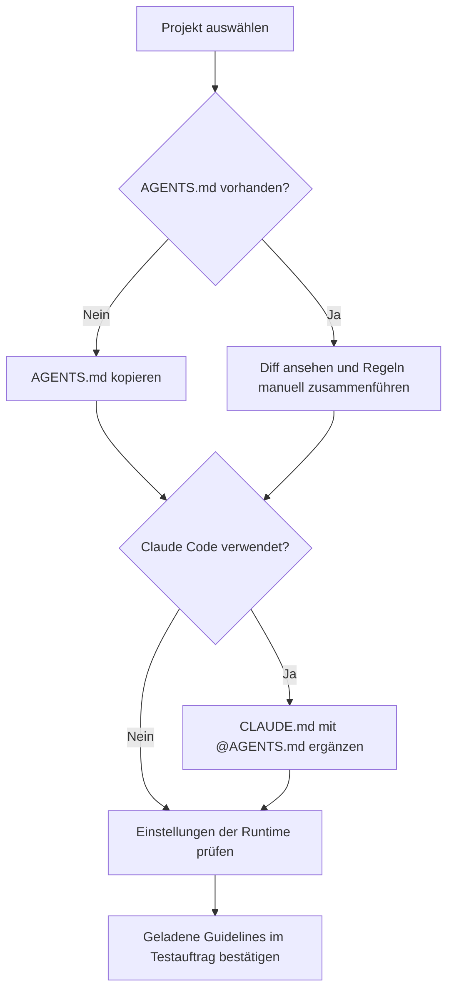

# 09 – Dateien kopieren statt installieren

Du brauchst **keine Installation, kein Python und keine Skripte**. Dieses Repository enthält nur kopierbare Markdown-Guidelines für das Verhalten von Coding-Agenten.

## A. Bestehendes Projekt

1. `AGENTS.md` aus dem Kit in die Projektwurzel kopieren.
2. Falls Claude Code verwendet wird, auch `CLAUDE.md` kopieren. Diese enthält nur `@AGENTS.md`.
3. **Wenn eine gleichnamige Datei schon existiert: nicht ersetzen.** Inhalt per Diff prüfen und neue Policy-Regeln bewusst ergänzen.
4. Beim ersten Auftrag prüfen, ob die Runtime die Policy tatsächlich geladen hat.

Optional per Terminal, wenn du das Kit lokal hast:

```bash
cd /pfad/zum/zielprojekt
cp -n /pfad/zum/portable-agentic-policy-kit/AGENTS.md .
cp -n /pfad/zum/portable-agentic-policy-kit/CLAUDE.md .
```

`cp -n` überschreibt vorhandene Dateien nicht. Bei bereits existierender `AGENTS.md` ist ein manuelles Merge erforderlich.

## B. Neues Projekt

```bash
mkdir -p mein-projekt
cd mein-projekt
cp -n /pfad/zum/portable-agentic-policy-kit/AGENTS.md .
cp -n /pfad/zum/portable-agentic-policy-kit/CLAUDE.md .
```

Das erzeugt lediglich den Ordner und die Agent-Guidelines – **keine Anwendung und keinen Tech-Stack**.

## C. Ollama mit Agent-Harness

Den Text von `AGENTS.md` als System-/Agent-Instruktionen im tatsächlich verwendeten Harness hinterlegen. Die bloße Ablage der Markdown-Datei hat für Ollama ohne diesen Mechanismus keine Wirkung.

## D. Spätere Updates

Die Regeln in `AGENTS.md` des Kits mit der Version im Projekt vergleichen; Änderungen manuell übernehmen. Wenn das Projekt eigene Regeln ergänzt hat, diese bewahren.



**Sicherheit:** Das Kopieren von Markdown-Dateien installiert nichts und startet keinen Code. Technische Rechte müssen dennoch separat über die Runtime kontrolliert werden. Siehe [SECURITY.md](../SECURITY.md).
