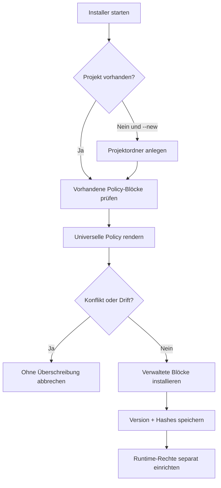

# 09 – Installation ohne Framework-Vorgaben

Das Portable Agentic Policy Kit legt **nur Agentic-Coding-Guidelines** an. Es erkennt keine Frameworks, nimmt keine Technologieauswahl vor und erzeugt keine Anwendung.

## Bestehendes Projekt

```bash
python3 /pfad/zum/kit/tooling/install.py --project .
```

Der Installer ergänzt `AGENTS.md` und `CLAUDE.md` in gekennzeichneten Blöcken. Andere vorhandene Anweisungen, Quellcode und Konfigurationsdateien werden nicht umgeschrieben. Unter `.agentic/` entstehen Installationsstatus, ein Modell-Prompt und eine optionale Quality-Gate-Vorlage.

## Neues Projektverzeichnis

```bash
python3 /pfad/zum/kit/tooling/install.py --new meine-app
```

Es wird ein leerer Projektordner mit der universellen Policy angelegt. Deine eigentliche Anwendung und deren Tech-Stack erstellst du unabhängig davon.

## Privates GitHub-Repo

```bash
gh auth login
(tmp=$(mktemp -d); trap 'rm -rf -- "$tmp"' EXIT; gh repo clone pancoda-software/portable-agentic-policy-kit "$tmp/kit" -- --quiet --depth 1 && python3 "$tmp/kit/tooling/install.py" --project .)
```

Nach Veröffentlichung auf `public` ist ein optionaler Bootstrap möglich (siehe README). Ein gepinnter Tag oder eine geprüfte lokale Kopie ist sicherer als `curl | bash` von einem beweglichen Branch.

## Update / Dry Run / Prüfung

```bash
python3 /pfad/zum/kit/tooling/install.py --project . --dry-run
python3 /pfad/zum/kit/tooling/install.py --project .
python3 /pfad/zum/kit/tooling/install.py --project . --check
```

Bereits verwaltete Abschnitte werden nur ersetzt, wenn ihr gespeicherter Hash stimmt. Eigenmächtig veränderte Blöcke verursachen einen bewusst sichtbaren Abbruch. Schema-1-Konfigurationen aus älteren Installationen werden bei korrekter Installationshistorie zu Schema 2 migriert, ohne ein altes Technologieprofil zu übernehmen.

## Installationsablauf



## Optional: Tests aus dem Projekt

Das Kit weiß nicht, womit das Projekt gebaut wird. Es führt Tests erst aus, wenn du in `.agentic/checks.json` konkrete Befehle hinterlegt und `--allow-checks` freigegeben hast:

```json
{
  "schema": 1,
  "checks": {
    "test": ["your-project-test-command", "arg1"]
  }
}
```

```bash
bash .agentic/agent-verify.sh --risk medium --allow-checks
```

Die Tests sind projektspezifische Eingaben, **keine Vorgaben des Policy Kits**. Alle weiteren Sicherheits- und Freigabeanforderungen stehen in der universellen Policy.
