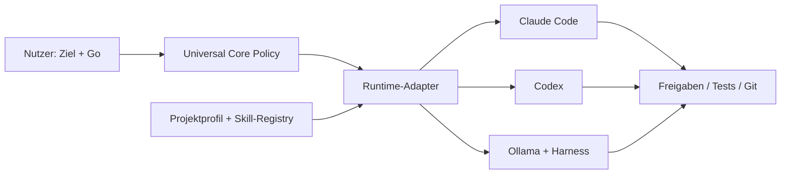

# Dokumentation – Portable Agentic Policy Kit

Dieses Handbuch beschreibt **nicht nur die Dateien**, sondern das Zusammenspiel von Nutzer, Hauptagent, Sub-Agenten, Modellen, Skills, Projektwerkzeugen und Sicherheitsgrenzen. Die folgenden Mermaid-Diagramme werden von GitHub direkt gerendert.

## Empfohlener Leseweg

| Kapitel | Zielgruppe | Was wird beantwortet? |
|---|---|---|
| [01 – Architektur](01-architektur.md) | Alle | Was sind die drei Ebenen und wer entscheidet was? |
| [02 – Workflows](02-workflows.md) | Anwender, Agent-Entwickler | Wie laufen Freigabe, Delegation, Tests, Commits und Fehlerbehebung? |
| [03 – Runtime-Integration](03-runtime-integration.md) | Administratoren | Wie werden Claude Code, Codex und Ollama mit den Regeln verbunden? |
| [04 – Praxisbeispiele](04-praxisbeispiele.md) | Entwickler | Wie sieht eine Anwendung bei Nuxt, Python und lokalen LLMs aus? |
| [05 – Sicherheit und Qualität](05-sicherheit-qualitaet.md) | Reviewer | Was ist technisch abgesichert, was nur Policy? |
| [06 – Grill-me-Entscheidungen](06-session-entscheidungen.md) | Projektbetreiber | Warum wurden D-01 bis D-11 gewählt? |
| [07 – Troubleshooting und FAQ](07-troubleshooting.md) | Alle | Was tun bei fehlenden Skills, Drifts, blockierten Commits usw.? |

## Kurzüberblick

## Begriffsklärung

- **Policy:** gewünschte Regeln für Entscheidungen und Verhalten; keine technische Sandbox.
- **Runtime / Agent-Harness:** Software, die Dateien, Shell, Sub-Agenten, Freigaben und Tools tatsächlich verwaltet.
- **LLM / Modell:** Denk- und Generierungsmodell (z. B. Claude, GPT, Qwen). Das Modell ist nicht die Runtime.
- **Inferenz-Backend:** Laufzeit für das Modell (z. B. Ollama oder ein API-Dienst).
- **Quality Gate:** nachweisbare Prüfung, ob eine Änderung hinreichend verifiziert ist.
- **Approval:** konkrete Berechtigung zu einem definierten Scope und einer Operation, nicht pauschal für alle Aktionen.
- **Baseline:** nachvollziehbarer Zustand vor einer Änderung. Hilft bei der Einordnung bestehender Testfehler.

> **Wichtiger Hinweis:** Das Kit erzeugt Instruktionsdateien und validiert ihre Konsistenz. Es richtet keine Betriebssystem-Sandbox ein und erzwingt nicht selbst die Agentenrechte. [SECURITY.md](../SECURITY.md) nennt die Grenzen.
