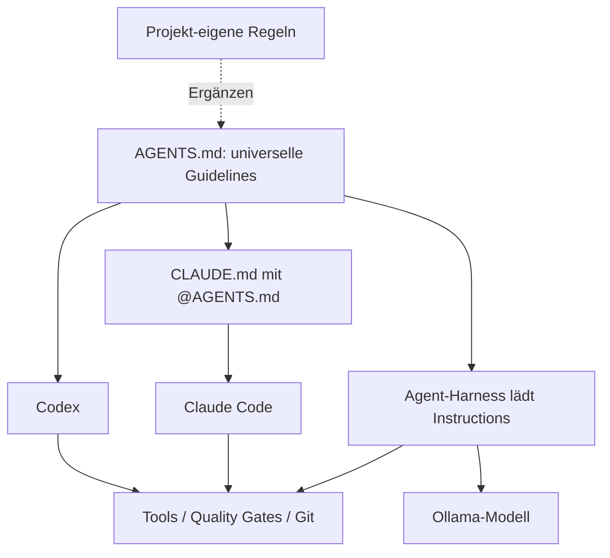

# Dokumentation – Portable Agentic Policy Kit

Alle Inhalte sind **Markdown-Dateien**. Es gibt weder einen Installer noch Code, der vor der Nutzung ausgeführt werden muss.

| Kapitel | Inhalt |
|---|---|
| [01 – Architektur](01-architektur.md) | Universelle Policy, Runtime und projekt-eigene Regeln |
| [02 – Workflows](02-workflows.md) | Freigaben, Routing, Quality Gates, Recovery und Git als Mermaid-Diagramme |
| [03 – Runtime-Integration](03-runtime-integration.md) | Claude Code, Codex und Ollama mit Agent-Harness |
| [04 – Praxisbeispiele](04-praxisbeispiele.md) | Frameworkunabhängige Szenarien |
| [05 – Sicherheit und Qualität](05-sicherheit-qualitaet.md) | Berechtigungen, Prüfungen und Grenzen |
| [06 – Interviewentscheidungen](06-session-entscheidungen.md) | Grill-me-Beschlüsse D-01 bis D-11 |
| [07 – Troubleshooting](07-troubleshooting.md) | Instructions werden nicht geladen, Konflikte, fehlende Tools |
| [08 – Veröffentlichung](08-publication-checklist.md) | Datenschutz und Historienprüfung vor einem Public-Release |
| [09 – Dateien kopieren](09-dateien-kopieren.md) | Praktische Anwendung in bestehenden und neuen Projekten |

Eine Markdown-Anweisung ist keine technisch durchgesetzte Berechtigung. Der jeweilige Agent-Harness muss Toolrechte und Freigaben eigenständig kontrollieren.
