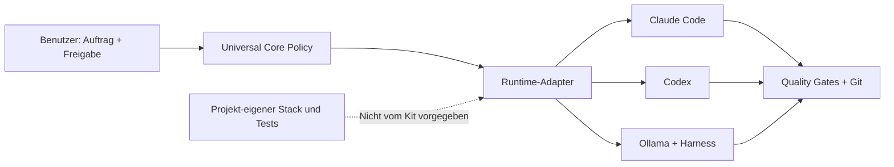

# Dokumentation – Portable Agentic Policy Kit

Diese Dokumentation beschreibt ausschließlich **framework- und sprachunabhängige Agentic-Coding-Guidelines**: Freigaben, adaptive Orchestrierung, Routing, Skills, Sicherheit, Quality Gates, Recovery und Git.

| Kapitel | Inhalt |
|---|---|
| [01 – Architektur](01-architektur.md) | Universelle Core-Policy, Runtime-Adapter und projekt-eigene Regeln |
| [02 – Workflows](02-workflows.md) | End-to-End-Flows mit Mermaid-Diagrammen |
| [03 – Runtime-Integration](03-runtime-integration.md) | Claude Code, Codex und Ollama-Harnesses |
| [04 – Praxisbeispiele](04-praxisbeispiele.md) | Stackunabhängige Aufgaben und Fehlerfälle |
| [05 – Sicherheit und Qualität](05-sicherheit-qualitaet.md) | Berechtigungen, testbare Gates und Grenzen |
| [06 – Interviewentscheidungen](06-session-entscheidungen.md) | Beschlüsse D-01 bis D-11 |
| [07 – Troubleshooting](07-troubleshooting.md) | Installation, Konflikte und Fehlerbehandlung |
| [08 – Veröffentlichung](08-publication-checklist.md) | Datenschutz- und Historienprüfung vor Public |
| [09 – Einfach installieren](09-einfach-installieren.md) | Ein-Befehl-Installation und Updates |

**Merke:** Die Policy ist keine Sandbox. Berechtigungen und Tool-Aufrufe müssen von der jeweiligen Runtime technisch kontrolliert werden. Das Kit wählt keinen Stack und installiert keine Frameworks.
